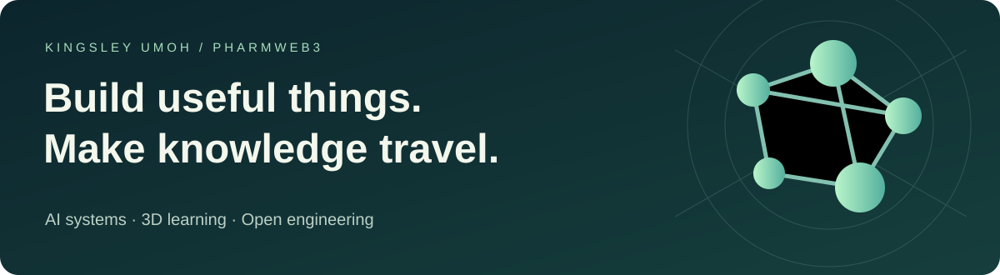

# Kingsley Umoh

**Founder of PharmWeb3 · AI product engineer · Full-stack developer · Pharmacy student**

> **Making healthcare free and accessible to all.** I founded PharmWeb3 to bridge the gap between people and licensed pharmacists—using technology to make professional guidance easier to reach, without cost being the first obstacle.

**Why I build:** Someone who needs medicine guidance should not have to struggle to find a qualified pharmacist or pay just to ask for help. PharmWeb3 was founded in **2023** around that belief.

**What PharmWeb3 does:** It is a **virtual healthcare-access bridge**, not a physical pharmacy. People use the platform to reach **licensed pharmacists for free professional consultations and medication guidance**. PharmWeb3 builds the digital experience, including AI-assisted navigation and pharmacist handoff; **licensed pharmacists deliver the professional care**. A licensed lead pharmacist works with the core team, and the founder reports that the end-to-end connection flow is functioning.

**Where the mission goes next:** Beyond free guidance, the white paper sets out health education, sponsored medicine vouchers and support for medical bills through properly governed professional and pharmacy partnerships. Those wider assistance programmes are ambitions to build and scale, **not a promise that all medicines or medical services are free today**.

**Why the other tools matter:** **Kryptode** explores connectivity where mobile data is unreliable; **[Rank Raid](https://rankraid.world/)** helps businesses and services become discoverable; and **Profkingkeys World** explores immersive learning and outreach. Each is a separate product, with possible future ways to strengthen PharmWeb3's mission—not a claim that those integrations are already deployed.

[Visit PharmWeb3](https://pharmweb3.com/) · [My portfolio](https://pharmweb3.com/portfolio) · [Founder story, roadmap & evidence](PORTFOLIO.md) · [LinkedIn](https://www.linkedin.com/in/prof-king-keys-110a24229) · [X / Twitter](https://x.com/Profkingkeys)

## The PharmWeb3 ecosystem: one mission, different barriers

| Product | The problem it addresses | How it supports the PharmWeb3 mission | Current position |
|---|---|---|---|
| **[PharmWeb3](https://pharmweb3.com/)** · flagship | Cost, distance and complexity limit access to reliable pharmacist guidance and healthcare support | A virtual bridge connecting users with licensed pharmacists for **free professional consultations and guidance**; longer-term education, medicine vouchers and medical-bill support | Public platform; founder reports a functioning patient-to-pharmacist flow and a licensed lead pharmacist on the team. Wider financial-aid programmes need separately verified rollout |
| **Kryptode** · connectivity | Nearby people and businesses lose communication and discovery opportunities when mobile data is unavailable | Proposed channel for offline health education, nearby pharmacy discovery and community information exchange | Android peer-to-peer networking product in development; multi-device reliability and the PharmWeb3 integration still need validation |
| **[Rank Raid](https://rankraid.world/)** · visibility | New businesses and services struggle to get noticed online | A potential discovery and campaign channel that can direct attention to PharmWeb3 | Public browser product; source code is private; healthcare campaign performance has not been established |
| **Profkingkeys World** · engagement | Digital education and brand discovery often lack immersive experiences | Planned virtual pharmacy, health-education experiences and a space to discover PharmWeb3 | Virtual-world project in development; proposed PharmWeb3 experiences are not deployed |

**How it fits together:** Kryptode explores **access without continuous data**; Rank Raid explores **awareness and online reach**; Profkingkeys World explores **interactive education and discovery**. All three can support the **PharmWeb3 healthcare mission** without becoming substitutes for qualified medical care.

**A critical distinction:** Bluetooth and Wi-Fi peer-to-peer networking have limited range and depend on nearby compatible devices. Offline material cannot magically provide live consultations, AI inference, or up-to-date medical records without the necessary local capabilities and safeguards.

### Strengthening what already works

The immediate priority is **to grow and sustain free access to licensed pharmacist guidance**, not to build a physical pharmacy or claim that every long-term feature has launched. I want to improve the working consultation and handoff experience, support the pharmacist-led service, strengthen privacy and professional safeguards, and measure real outcomes through a focused pilot.

Funding would go toward core platform and cloud infrastructure, professional capacity, compliance, partnerships, user testing and outreach. We can then test whether Rank Raid lowers discovery costs and whether Kryptode can safely extend pre-approved health information to low-connectivity communities. Profkingkeys World remains a longer-term educational opportunity.

**Free for the patient does not mean costless to operate.** Potential sustainability routes include philanthropic funding, aligned partnerships and appropriate premium or institutional services—subject to validation, without making access to core free guidance dependent on payment. We do not present unverified user totals, commercial traction or clinical outcomes as facts.

[Read the fuller founder story, team model and evidence →](PORTFOLIO.md)

## A live product to explore: Rank Raid

[**Visit Rank Raid at rankraid.world →**](https://rankraid.world/)

Rank Raid is a 3D leaderboard experience for startups, founders, developers, businesses and creators. Visitors can explore the global tower and category rankings, add a website or social profile, and interact through rank competition, fortification and raids. It demonstrates how I approach online discovery through interactive product design.

The public site is available to try. **Its private source repository is intentionally not linked here.** The presence of a game and payment flow does not establish advertiser return on investment or traction for PharmWeb3.

[Explore Rank Raid](https://rankraid.world/) · [How it works](https://rankraid.world/how-to-play) · [Product story](RANK-RAID.md)

## Explore more of my work

### Learn to build with AI

[**The Practical AI Library →**](https://github.com/Profkingkeys/Ai-ebooks)

32 practical guides across coding, data analysis, healthcare, creative work, business and advanced AI research. Includes setup, model selection, worked exercises, sources and an offline reader.

[Download the reader](https://github.com/Profkingkeys/Ai-ebooks/releases/latest/download/AI-Library.html) · [Data Analysis with AI](https://github.com/Profkingkeys/Ai-ebooks/blob/main/chapters/32-data-analysis-with-ai.md) · [Code across the stack](https://github.com/Profkingkeys/Ai-ebooks/blob/main/chapters/09-vibecoding.md)

### Practice in a 3D world

[**Pharma Simulation →**](https://github.com/Profkingkeys/Pharma-Simulation)

A browser campaign covering fictional suspension, ointment and solution dispensing workflows. A furnished lab, visible decisions, feedback, retry and independent-release checks. An educational prototype awaiting pharmacy/curriculum validation.

[Download the offline game](https://github.com/Profkingkeys/Pharma-Simulation/releases/latest/download/Pharma-Simulation.html)

[**KidSim →**](https://github.com/Profkingkeys/Kid-Simulation)

A 3D home adventure with five healthy-habit missions: handwashing, medicine safety, cough care, safe drinking water and hot cookware. Automatic character movement, a timed handwashing routine and gentle retries. No account or tracking.

[Download the offline game](https://github.com/Profkingkeys/Kid-Simulation/releases/latest/download/Kid-Simulation.html) · [Explore the simulation collection](https://github.com/Profkingkeys/Simulation-Games)

### Inspect the public engineering

[**PharmWeb3 engineering labs →**](https://github.com/Profkingkeys/PharmWeb3)

Runnable labs for AI tool routing, SaaS boundaries, MySQL, paper-trading research, telemetry and Android. Source, tests and CI make the implementation reviewable. These are engineering demonstrations, not claims of clinical deployment or production scale.

[Run the labs](https://github.com/Profkingkeys/PharmWeb3#run-the-labs) · [Build and APK evidence](https://github.com/Profkingkeys/PharmWeb3/actions/workflows/ci.yml)

## Prompt engineering and early AI adoption

I am an **early ChatGPT user and prompt engineer**, with documented engagement across the early generative-AI era. My records include an **OpenAI developer announcement received in December 2022**, OpenAI's **ChatGPT/Whisper API update in March 2023**, and participation in **Microsoft's new Bing AI preview waitlist in February 2023**, followed by a **preview access invitation in May 2023**.

I apply that experience by crafting structured instructions, refining prompts through iteration, evaluating outputs, and turning ideas into practical AI-assisted software workflows.

**Evidence you can reproduce:** [Dated OpenAI and Bing AI timeline, exact email subjects, and copy-paste Gmail searches](EARLY_AI_ADOPTION_EVIDENCE.md). An OpenAI product announcement is not proof of an exact ChatGPT signup date; the original dates of the historical chat links below remain unverified.

**Historical ChatGPT conversations:** [Conversation 1](https://chatgpt.com/s/t_69b8030cbf388191b66834b41e49bb2b) · [Conversation 2](https://chatgpt.com/s/t_69b803df1b688191a46d9c204e5e0663) · [Conversation 3](https://chatgpt.com/s/t_69b80496c5f48191bf43b9f96bfb7fb9)

## How I build and lead

1. **Understand the problem.** Identify the user, the current workaround and the cost of getting it wrong.
2. **Ship a complete small loop.** Make the main task usable before expanding the feature list.
3. **Make evidence visible.** Preserve sources, tests, limitations and a reproducible demonstration.
4. **Improve with others.** Invite users and domain experts to challenge assumptions and guide the next release.

[Leadership principles](LEADERSHIP.md) · [Portfolio evidence and vision](PORTFOLIO.md) · [Technology map](STACK.md)

## Technologies in this portfolio

**Web & 3D:** HTML, CSS, JavaScript, Node.js, Three.js, WebGL, responsive interfaces and explicit game-state models.

**AI & data:** tool interfaces, model evaluation patterns, Python data validation, MySQL, source-grounded workflows and structured telemetry.

**Mobile & delivery:** Kotlin, Java, Android WebView, Gradle, emulator checks, GitHub Actions and static/offline publishing.

**Learning examples:** Rust validation, Solidity contracts and cross-stack development guides. **Research direction:** Filament rendering, biomedical evidence tools and better evaluation of advanced AI. These directions are distinct from shipped features.

## Current checks

## Collaborate

Open to software roles, healthcare and education projects, research tooling, technical writing, and thoughtful founder collaborations. For the PharmWeb3 mission, I'm interested in learning from pharmacists, healthcare organisations, community partners, accessibility advocates and responsible AI practitioners.

**Find an overlooked problem. Build something useful. Connect it to a larger mission. Let the evidence speak.**
